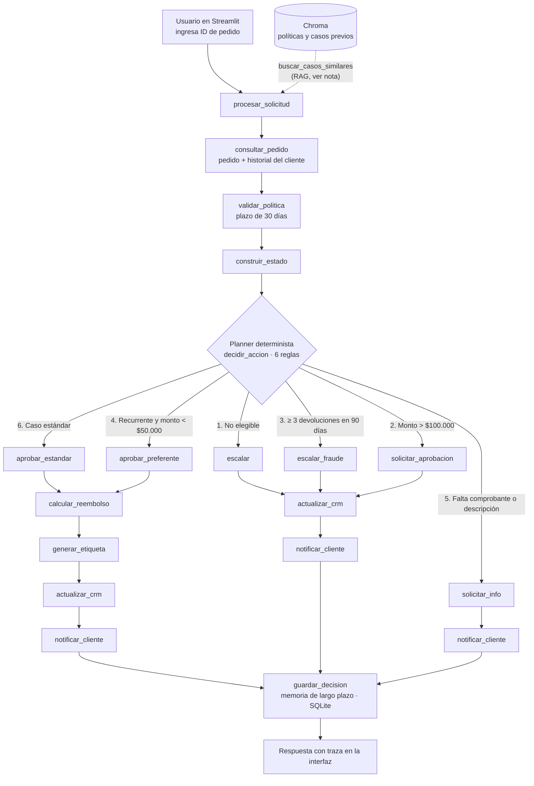

# Diagrama de orquestación — TechStore Returns

Fuente Mermaid. Para incluirlo en el informe: pegar el bloque en https://mermaid.live, exportar a PNG o SVG e insertar la imagen en la sección 3.

**Nota para el equipo:** la línea punteada indica la recuperación semántica. Debe reflejar exactamente dónde se usa en el código. Si `buscar_casos_similares` no forma parte del flujo `procesar_solicitud`, o solo lo usa el `AgentExecutor`, hay que dibujarlo en ese lugar y no en la posición actual.
